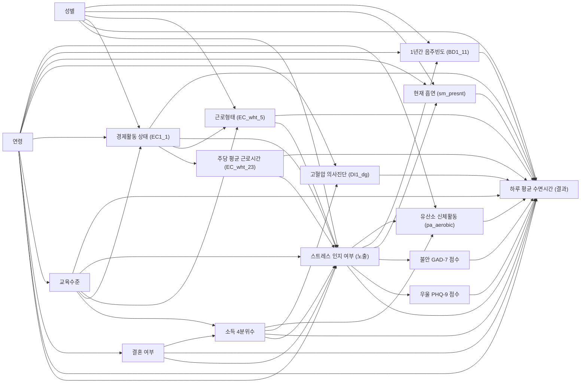

**C-1. DAG와보정집합**

| 변수명 | 분류 역할 | 근거 (시간 순서 · 선행연구 요약) |
| :--- | :--- | :--- |
| 연령 | 교란변수 | 생애주기 전반에 걸쳐 스트레스 인지 수준과 수면시간(연령별 수면 패턴 변화) 모두에 영향을 주는 선행 요인임. |
| 성별 | 교란변수 | 성별에 따른 스트레스 지각 차이 및 수면시간·수면구조 차이가 선행연구에서 반복적으로 보고됨. |
| 결혼 여부 | 교란변수 | 가구 형태와 사회적 지지·부양 부담은 스트레스와 수면시간 양쪽에 영향을 줄 수 있음. |
| 소득 4분위수 | 교란변수 | 경제적 여건은 생활 스트레스와 주거·생활환경을 통한 수면시간 모두에 공통으로 작용함. |
| 교육수준 | 교란변수 | 교육수준은 직업·경제적 지위와 건강문해력·생활습관을 통해 스트레스와 수면시간에 모두 영향을 줌. |
| 경제활동 상태 (`EC1_1`) | 교란변수 | 취업/비경제활동 여부는 일상적 업무 스트레스와 생활리듬(기상·취침 시간)에 함께 관여함. |
| 주당 평균 근로시간 (`EC_wht_23`) | 교란변수 | 장시간 근로 여부는 직무 스트레스와 가용 수면시간 모두에 영향을 미칠 수 있음. |
| 근로형태 (`EC_wht_5`) | 교란변수 | 고용·근로형태(정규/비정규/교대·자영업 등)는 스트레스와 수면시간에 공통 원인으로 작용 가능함. |
| 고혈압 의사진단 (`DI1_dg`) | 교란변수 | 만성질환 진단 여부는 건강 스트레스와 신체적 불편·증상으로 인한 수면 변화에 함께 관련될 수 있음. |
| 현재 흡연 (`sm_presnt`) | 매개변수 | 스트레스 대처 행동으로 흡연이 늘고 니코틴 각성 효과 등으로 수면에 영향을 주는 경로를 가정함. |
| 1년간 음주빈도 (`BD1_11`) | 매개변수 | 스트레스 완화 목적의 음주가 수면의 질·수면시간 변화로 이어지는 경로를 가정함. |
| 유산소 신체활동 (`pa_aerobic`) | 매개변수 | 스트레스 상태에서 신체활동이 줄고 신체활동 변화가 수면시간에 영향을 미치는 경로로 설정함. |
| 우울 PHQ-9 점수 | 매개변수 | 지속적 스트레스가 우울 증상을 유발하고 우울 증상이 수면시간 변화를 초래하는 경로를 우선 가정함. |
| 불안 GAD-7 점수 | 매개변수 | 스트레스 반응으로 불안 증상이 높아지고 과각성·불안이 수면시간에 영향을 주는 경로로 설정함. |

### 보정집합
- **추정 대상:** 스트레스 인지 여부가 하루 평균 수면시간에 미치는 총효과를 추정합니다.
- **최소 보정집합(교란변수):** 연령, 성별, 결혼 여부, 소득 4분위수, 교육수준, 경제활동 상태, 주당 평균 근로시간, 근로형태, 고혈압 의사진단)를 보정집합으로 설정하고, 노출 이후 나타날 수 있는 매개변수(우울 PHQ-9, 불안 GAD-7, 현재 흡연, 1년간 음주빈도, 유산소 신체활동는 총효과 희석을 피하기 위해 주 모형(모형 2) 보정집합에서 제외합니다.

### 애매한 변수 및 12주차 민감도분석 계획
- **역할이 애매한 변수 및 처리 방식:** 단면조사에서는 우울(PHQ-9), 불안(GAD-7), 흡연·음주·신체활동이 스트레스 이후의 매개변수인지, 반대로 수면 부족·정신건강이 스트레스 인지에 선행하는 교란변수/역인과인지 시점만으로 단정하기 어렵습니다. 이에 C-1에서는 스트레스 -> 정서·행태 요인 -> 수면시간의 매개변수로 우선 분류해 주 모형(모형 2)에서 제외했습니다.
- **12주차 민감도분석 계획:**
1. 애매한 정신건강 변수(우울 PHQ-9, 불안 GAD-7)를 보정변수에 추가한 모형 3(또는 민감도 모형)을 적합해 모형 2와 추정치 변화를 비교합니다.
2. 결측치가 많은 변수(예: 주당 평균 근로시간 등)를 보정집합에 포함할 때 발생하는 완전 사례 축소 폭을 점검하고, 공변량 구성을 달리했을 때의 결과 안정성을 확인합니다.

**C-2 table 2**

**Table 2. 스트레스 인지와 하루 평균 수면시간(시간)의 관련성: 선형 회귀 β (95% CI)**

| | 모형 1 (무보정) | 모형 2 (DAG 보정집합) | 모형 3 (모형 2 + 우울·불안) |
|---|---|---|---|
| 스트레스 인지 (기준: 비인지) β (95% CI) | -0.146 (-0.228, -0.064) | -0.187 (-0.269, -0.104) | -0.129 (-0.226, -0.033) |
| p값 | <0.001 | <0.001 | 0.009 |
| 분석 인원 (명) | 5,396 | 5,396 | 5,386 |
| Table 1(5,800명) 대비 | -404 | -404 | -414 |

**각주**
- a. 모형: 선형 회귀. 계수는 가중치로 추정했고, 표준오차와 95% 신뢰구간은 층과 집락을 반영한 선형화(Taylor) 방법으로 구했습니다. 자유도는 집락 수에서 층 수를 뺀 값입니다.
- b. 가중치 `wt_itvex`, 층 `kstrata`, 집락 `psu`. 행을 지우지 않고 분석 대상 밖이거나 보정변수가 결측인 사람은 가중치를 0으로 두는 도메인 분석을 썼습니다.
- c. 보정변수: 모형 2는 연령, 성별, 결혼 여부, 소득 4분위, 교육수준, 경제활동 상태. 모형 3은 여기에 우울 PHQ-9, 불안 GAD-7을 더했습니다. 범주형 변수는 가장 작은 코드를 기준 범주로 했습니다.
- d. 결측 처리: 완전 사례 분석(보정변수가 하나라도 없는 사람 제외). 모형 1도 모형 2와 같은 사람으로 다시 적합했습니다.
- e. 자료: 2024년 국민건강영양조사

**C-3. 결과 해석**

결과: 교란변수를 보정한 모형 2에서, 평소 스트레스를 많이 인지하는 군은 그렇지 않은 군(비인지)에 비해 하루 평균 수면시간이 0.187시간(약 11.2분) 유의하게 짧았다 (회귀계수 β = -0.187, 95% 신뢰구간: -0.269 ~ -0.104, p < 0.001). 즉, 스트레스 인지와 수면시간 사이에는 통계적으로 유의한 음의 관련성이 관찰되었다.

보정 전후:
무보정 모형인 모형 1의 회귀계수는 -0.146 (95% 신뢰구간: -0.228 ~ -0.064)이었으나, 교란변수를 통제한 모형 2에서는 -0.187 (95% 신뢰구간: -0.269 ~ -0.104)로 음의 방향으로 효과 크기가 더 커졌다.

C-1에서 설정한 DAG 구조상 연령, 성별, 결혼 여부, 소득 4분위수, 교육수준, 경제활동 상태, 주당 평균 근로시간, 근로형태, 고혈압 의사진단 여부는 스트레스 인지와 수면시간 모두에 영향을 미치는 공통 원인(교란변수)이다.

보정 전에는 이러한 사회경제적, 인구학적, 건강 요인들의 교란 효과가 섞여 스트레스와 수면시간 간의 실제 관련성이 일부 희석되어 나타났으나, 보정을 통해 교란 경로를 차단함으로써 순수한 총효과가 더 뚜렷하게 드러난 것으로 해석할 수 있다.
