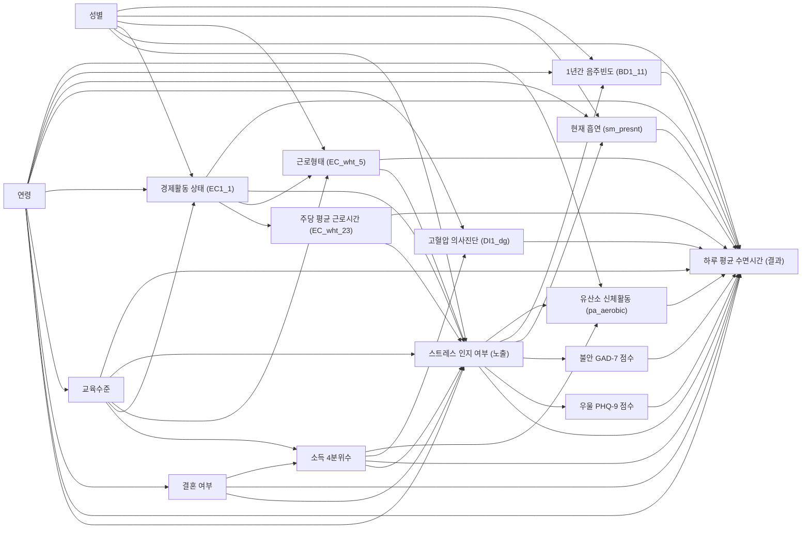

| 변수명 | 분류 역할 | 근거 (시간 순서 · 선행연구 요약) |
| :--- | :--- | :--- |
| 연령 | 교란변수 | 생애주기 전반에 걸쳐 스트레스 인지 수준과 수면시간(연령별 수면 패턴 변화) 모두에 영향을 주는 선행 요인임. |
| 성별 | 교란변수 | 성별에 따른 스트레스 지각 차이 및 수면시간·수면구조 차이가 선행연구에서 반복적으로 보고됨. |
| 결혼 여부 | 교란변수 | 가구 형태와 사회적 지지·부양 부담은 스트레스와 수면시간 양쪽에 영향을 줄 수 있음. |
| 소득 4분위수 | 교란변수 | 경제적 여건은 생활 스트레스와 주거·생활환경을 통한 수면시간 모두에 공통으로 작용함. |
| 교육수준 | 교란변수 | 교육수준은 직업·경제적 지위와 건강문해력·생활습관을 통해 스트레스와 수면시간에 모두 영향을 줌. |
| 경제활동 상태 (`EC1_1`) | 교란변수 | 취업/비경제활동 여부는 일상적 업무 스트레스와 생활리듬(기상·취침 시간)에 함께 관여함. |
| 주당 평균 근로시간 (`EC_wht_23`) | 교란변수 | 장시간 근로 여부는 직무 스트레스와 가용 수면시간 모두에 영향을 미칠 수 있음. |
| 근로형태 (`EC_wht_5`) | 교란변수 | 고용·근로형태(정규/비정규/교대·자영업 등)는 스트레스와 수면시간에 공통 원인으로 작용 가능함. |
| 고혈압 의사진단 (`DI1_dg`) | 교란변수 | 만성질환 진단 여부는 건강 스트레스와 신체적 불편·증상으로 인한 수면 변화에 함께 관련될 수 있음. |
| 현재 흡연 (`sm_presnt`) | 매개변수 | 스트레스 대처 행동으로 흡연이 늘고 니코틴 각성 효과 등으로 수면에 영향을 주는 경로를 가정함. |
| 1년간 음주빈도 (`BD1_11`) | 매개변수 | 스트레스 완화 목적의 음주가 수면의 질·수면시간 변화로 이어지는 경로를 가정함. |
| 유산소 신체활동 (`pa_aerobic`) | 매개변수 | 스트레스 상태에서 신체활동이 줄고 신체활동 변화가 수면시간에 영향을 미치는 경로로 설정함. |
| 우울 PHQ-9 점수 | 매개변수 | 지속적 스트레스가 우울 증상을 유발하고 우울 증상이 수면시간 변화를 초래하는 경로를 우선 가정함. |
| 불안 GAD-7 점수 | 매개변수 | 스트레스 반응으로 불안 증상이 높아지고 과각성·불안이 수면시간에 영향을 주는 경로로 설정함. |
