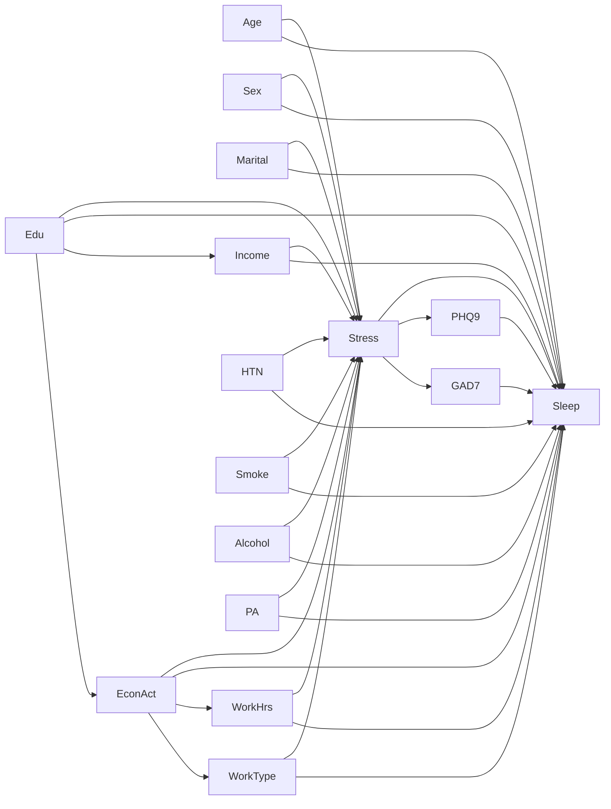

# 11주차 — DAG와 복합표본 회귀

> 초안입니다. `[노트북 출력]` 표시는 `code/11_regression.ipynb`를 실행한 뒤 출력값으로 채웁니다.
> 노출·결과·대상자 정의는 10주차 Table 1과 동일합니다.

## C-1. DAG와 보정집합

### 추정 대상
- **노출**: 스트레스 인지 (`mh_stress`, 고위험군 vs 저위험군)
- **결과**: 하루 평균 수면시간 (시간, 연속형)
- **추정 대상**: 총효과 (스트레스 인지 고위험과 수면시간의 관련성 전체)

### DAG

(Stress = 스트레스 인지 고위험, Sleep = 수면시간, Marital = 결혼 여부, Edu = 교육수준, Income = 소득 4분위, EconAct = 경제활동 상태, WorkHrs = 주당 근로시간, WorkType = 근로형태, HTN = 고혈압 의사진단, Smoke = 현재 흡연, Alcohol = 음주빈도, PA = 유산소 신체활동, PHQ9 = 우울, GAD7 = 불안)

### 역할 표

| 변수 | 역할 | 근거 (시간 순서·선행연구) |
|---|---|---|
| 연령 | 교란 | 스트레스 인지와 수면시간보다 먼저 정해지며 둘 다에 영향 (Table 1에서도 노출군이 더 젊음) |
| 성별 | 교란 | 선천적 특성으로 스트레스 인지와 수면 양상 모두에 영향 |
| 결혼 여부 | 교란 | 생활 여건으로 스트레스와 수면에 모두 관련 `[선행연구 보강]` |
| 교육수준 | 교란 | 성인기 스트레스와 수면습관보다 먼저 정해지는 사회경제적 요인 |
| 소득 4분위 | 교란 | 경제적 부담과 수면환경에 모두 관여 `[선행연구 보강]` |
| 경제활동 상태 | 교란 | 취업 여부가 스트레스 인지와 수면시간 모두에 영향 |
| 주당 근로시간 | 교란 | 장시간 근로가 스트레스와 수면 부족의 공통 원인 `[선행연구 보강]` |
| 근로형태 | 교란 | 고용 형태(안정성 등)가 스트레스와 수면에 공통 영향 `[선행연구 보강]` |
| 고혈압 의사진단 | 교란 | 만성질환은 오래 전에 진단된 상태로 현재 스트레스 인지와 수면에 앞서 존재 `[선행연구 보강]` |
| 현재 흡연 | 교란 | 오래 형성된 생활습관이 스트레스 인지와 수면에 앞서 존재 `[선행연구 보강]` |
| 음주빈도 | 교란 | 위와 같음 `[선행연구 보강]` |
| 유산소 신체활동 | 교란 | 위와 같음 `[선행연구 보강]` |
| 우울 PHQ-9 | 애매 (매개로 가정) | 스트레스 → 우울 → 수면 장애 경로를 가장 그럴듯하게 봄. PHQ-9에는 수면 문항이 포함되어 결과와 측정이 겹침 |
| 불안 GAD-7 | 애매 (매개로 가정) | 스트레스 → 불안 → 수면 장애 경로를 가장 그럴듯하게 봄 |

### 보정집합
- **최소 보정집합 (모형 2)**: 연령, 성별, 결혼 여부, 교육수준, 소득 4분위, 경제활동 상태, 주당 근로시간, 근로형태, 고혈압 의사진단, 현재 흡연, 음주빈도, 유산소 신체활동
- dagitty.net 결과: `[dagitty 입력 후 "Minimal sufficient adjustment sets" 결과를 붙여넣기]`
- 우울·불안은 총효과의 경로 위에 있다고 보아 모형 2에서 보정하지 않음

### 애매한 변수
- **우울(PHQ-9), 불안(GAD-7)**: 한 시점 자료로는 스트레스와의 선후를 알 수 없어 가장 그럴듯한 역할(매개)로 정했고, 모형 3에 더해 계수 변화를 확인함.
- 고혈압·흡연·음주·신체활동도 스트레스의 결과(매개)일 가능성이 있으나 교란으로 정함.
- 12주차 민감도분석: (1) 우울·불안을 넣고 뺀 모형 비교, (2) 고혈압·흡연·음주·신체활동을 빼고 다시 적합, (3) PHQ-9에서 수면 문항을 뺀 점수로 재분석 `[팀 합의 후 확정]`

## C-2. Table 2 — 무보정·보정 회귀

| 노출 | 모형 1 (무보정) β (95% CI) | p | 모형 2 (DAG 보정) β (95% CI) | p | 모형 3 (+우울·불안) β (95% CI) | p |
|---|---|---|---|---|---|---|
| 스트레스 고위험군 (기준: 저위험군) | `[노트북 출력]` | `[ ]` | `[노트북 출력]` | `[ ]` | `[노트북 출력]` | `[ ]` |
| 분석 인원 (명) | `[ ]` | | `[ ]` | | `[ ]` | |
| Table 1 대비 차이 (명) | `[ ]` | | `[ ]` | | `[ ]` | |

**각주**
- 가중치 `[노트북 출력]`, 층 `[노트북 출력]`, 집락 `[노트북 출력]`을 반영한 복합표본 선형 회귀. 분석 대상 밖은 가중치를 0으로 두는 도메인 분석.
- β는 스트레스 고위험군이 저위험군보다 하루 평균 수면시간이 몇 시간 다른지를 의미.
- 결과변수: 주중·주말 취침/기상 시각으로 계산한 하루 평균 수면시간 ((5×주중+2×주말)/7), 3시간 미만·16시간 초과 제외.
- 모형 2 보정변수: 연령, 성별, 결혼 여부, 교육수준, 소득 4분위, 경제활동 상태, 주당 근로시간(비취업 별도 범주), 근로형태, 고혈압 의사진단, 현재 흡연, 음주빈도, 유산소 신체활동. 모형 3은 모형 2에 우울(PHQ-9), 불안(GAD-7) 점수를 더함.
- 결측 처리: 완전 사례 분석. 모형 1도 보정변수가 모두 있는 사람으로 다시 적합. 비취업자의 근로시간은 구조적 결측이므로 별도 범주로 두어 제외하지 않음.
- 자료: 국민건강영양조사 2024 원시자료.

## C-3. 결과 해석

- **결과**: `[노트북 출력으로 채우기: 예) 스트레스 고위험군은 저위험군보다 하루 평균 수면시간이 약 ○시간 (95% CI ○~○) 짧았다.]`
- **보정 전후**: 모형 1 대비 모형 2에서 β가 `[○에서 ○로, 방향]` 바뀜. 이유는 `[DAG와 연결: 예) 연령 등 교란변수가 스트레스 인지(노출군이 더 젊음)와 수면시간에 함께 영향]`. 모형 3에서의 변화는 `[우울·불안이 경로 일부를 설명한 정도]`.
- **한계**: 한 시점 자료라 역방향 인과(수면 부족 → 스트레스 인지) 가능, 측정되지 않은 교란(직무 스트레스, 만성질환 등), 수면시간·스트레스 모두 자기 기입 자료의 오차.
- **12주차 계획**: (1) 우울·불안 등 애매한 변수 넣고 빼기 비교, (2) 수면시간 극단값 처리 기준 변경 또는 결측 처리 방법 변경.

## 역할 분담
`[팀원별 담당 작성]`

## AI 사용 내역
`[사용한 AI, 용도(예: DAG 초안, 문서 틀 작성, 노트북 코드 초안), 사람이 검토·수정한 부분 기록]`
